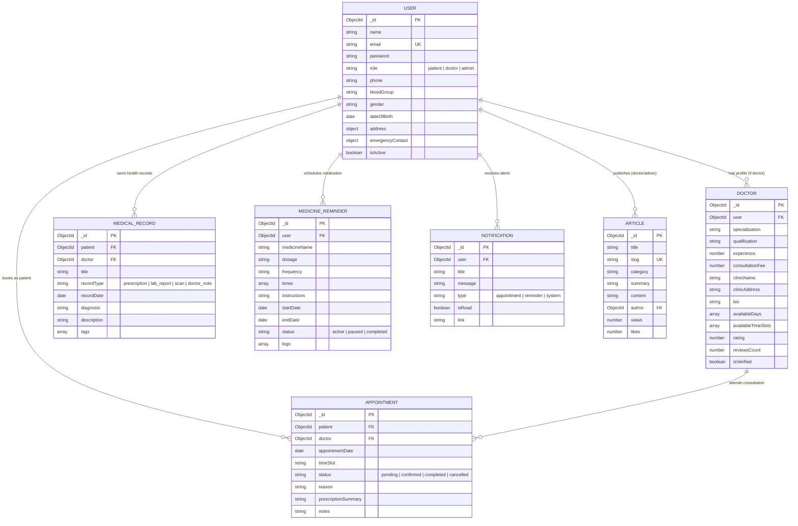

# 🏥 SEHATSAATHI (सेहत साथी)
### *Next-Generation Integrated Digital Healthcare Ecosystem*

[](https://react.dev)
[](https://nodejs.org)
[](https://mongodb.com)
[](https://tailwindcss.com)
[](LICENSE)

---

## 📌 1. Project Overview

**SehatSaathi** ("Your Healthcare Companion") is an enterprise-grade digital healthcare platform engineered to bridge patients, verified medical practitioners, and health administrators into a cohesive clinical ecosystem. Developed as a final-year B.Tech Capstone Project in Computer Science and Engineering, SehatSaathi replaces fragmented healthcare routines with an integrated solution featuring real-time appointment scheduling, lifetime encrypted medical vaults, automated prescription adherence tracking, and evidence-based wellness insights.

### 🌟 Key Highlights
- **100% Real Database Operations**: Powered by MongoDB with Mongoose ODM schemas, indexes, and relations — no mock arrays or hardcoded state.
- **Zero-Friction Evaluation**: Includes pre-configured realistic database seeding and automated embedded database fallback for instant demonstration.
- **Role-Based Access Control (RBAC)**: Dedicated tailored workflows and dashboard interfaces for **Patients**, **Doctors**, and **System Administrators**.
- **Modern Responsive Design**: Clean healthcare aesthetics using a teal and emerald color palette, glassmorphism cards, micro-interactions, and accessible typography.

---

## 🚀 2. Technology Stack

### Frontend
- **Framework**: React.js 18 (SPA)
- **Build Tool**: Vite (Lightning-fast HMR)
- **Styling**: Tailwind CSS (Teal/Emerald medical design system)
- **Routing**: React Router DOM v6
- **HTTP Client**: Axios with JWT Bearer Interceptors
- **Icons**: Lucide React
- **Typography**: Google Fonts Inter

### Backend
- **Runtime**: Node.js (v18+)
- **Framework**: Express.js REST API
- **Authentication**: JSON Web Tokens (JWT) & bcryptjs salted hashing
- **Middleware**: CORS, Morgan HTTP logger, Error handler
- **Embedded Database Option**: `mongodb-memory-server` fallback for zero-configuration testing

### Database
- **Engine**: MongoDB (v6.0+)
- **ODM**: Mongoose 8 (Schema validation, timestamps, hooks, population)

---

## 🏗️ 3. System Architecture & Database Models



---

## 📁 4. Project Folder Structure

```
SehatSaathi/
├── backend/
│   ├── config/             # Database connection & memory server
│   │   └── db.js
│   ├── controllers/        # REST API Controllers
│   │   ├── adminController.js
│   │   ├── appointmentController.js
│   │   ├── articleController.js
│   │   ├── authController.js
│   │   ├── doctorController.js
│   │   ├── medicalRecordController.js
│   │   ├── notificationController.js
│   │   └── reminderController.js
│   ├── middleware/         # Auth & Error Handling
│   │   ├── authMiddleware.js
│   │   └── errorMiddleware.js
│   ├── models/             # Mongoose Schemas (User, Doctor, Appointment, etc.)
│   │   ├── Appointment.js
│   │   ├── Article.js
│   │   ├── Doctor.js
│   │   ├── MedicalRecord.js
│   │   ├── MedicineReminder.js
│   │   ├── Notification.js
│   │   └── User.js
│   ├── routes/             # Express API Routes
│   │   ├── adminRoutes.js
│   │   ├── appointmentRoutes.js
│   │   ├── articleRoutes.js
│   │   ├── authRoutes.js
│   │   ├── doctorRoutes.js
│   │   ├── medicalRecordRoutes.js
│   │   ├── notificationRoutes.js
│   │   └── reminderRoutes.js
│   ├── utils/              # Token Generator & Seed Data
│   │   ├── generateToken.js
│   │   └── seedData.js
│   ├── .env.example
│   ├── package.json
│   ├── seeder.js           # CLI Seeder script
│   └── server.js           # Main Express server entrypoint
│
├── frontend/
│   ├── public/             # Static Assets & Favicons
│   │   └── favicon.svg
│   ├── src/
│   │   ├── components/     # UI Components
│   │   │   ├── appointments/  # BookingModal, AppointmentCard
│   │   │   ├── articles/      # ArticleCard, ArticleModal
│   │   │   ├── common/        # Navbar, Footer, Sidebar, Modal, StatCard, etc.
│   │   │   ├── records/       # RecordModal, RecordCard
│   │   │   └── reminders/     # ReminderModal, ReminderCard
│   │   ├── context/        # React Context (Auth, Notifications)
│   │   │   ├── AuthContext.jsx
│   │   │   └── NotificationContext.jsx
│   │   ├── layouts/        # Main & Dashboard Layouts
│   │   │   ├── DashboardLayout.jsx
│   │   │   └── MainLayout.jsx
│   │   ├── pages/          # 15 Complete Page Views
│   │   │   ├── AdminDashboard.jsx
│   │   │   ├── AppointmentsPage.jsx
│   │   │   ├── ArticleDetailPage.jsx
│   │   │   ├── ArticlesPage.jsx
│   │   │   ├── DoctorDashboard.jsx
│   │   │   ├── DoctorDetailPage.jsx
│   │   │   ├── DoctorListingPage.jsx
│   │   │   ├── HealthRecordsPage.jsx
│   │   │   ├── LandingPage.jsx
│   │   │   ├── LoginPage.jsx
│   │   │   ├── MedicineRemindersPage.jsx
│   │   │   ├── NotFoundPage.jsx
│   │   │   ├── NotificationsPage.jsx
│   │   │   ├── PatientDashboard.jsx
│   │   │   ├── ProfilePage.jsx
│   │   │   └── RegisterPage.jsx
│   │   ├── services/       # Axios API client services
│   │   │   ├── adminService.js
│   │   │   ├── api.js
│   │   │   ├── appointmentService.js
│   │   │   ├── articleService.js
│   │   │   ├── authService.js
│   │   │   ├── doctorService.js
│   │   │   ├── notificationService.js
│   │   │   ├── recordService.js
│   │   │   └── reminderService.js
│   │   ├── App.jsx         # Client routing
│   │   ├── index.css       # Tailwind CSS & custom scrollbars
│   │   └── main.jsx        # React root
│   ├── index.html
│   ├── package.json
│   ├── postcss.config.js
│   ├── tailwind.config.js
│   └── vite.config.js
│
├── .env.example            # Root environment template
├── .gitignore             # Git exclusions
└── README.md               # Master Documentation
```

---

## ⚡ 5. Installation & Setup Guide

### Prerequisites
- **Node.js**: v18.0.0 or higher
- **npm**: v9.0.0 or higher
- **MongoDB**: Local MongoDB instance (or MongoDB Atlas URI). *Note: If MongoDB is not installed locally, SehatSaathi automatically initializes an embedded in-memory MongoDB instance with pre-seeded data!*

### Step 1: Clone or Extract the Project
```bash
git clone https://github.com/your-username/SehatSaathi.git
cd SehatSaathi
```

### Step 2: Configure Environment Variables
Copy `.env.example` to `backend/.env` and `frontend/.env`:

```bash
# In backend directory
cp backend/.env.example backend/.env

# In frontend directory
cp frontend/.env.example frontend/.env
```

**Backend `.env` default settings:**
```env
PORT=5000
NODE_ENV=development
MONGO_URI=mongodb://127.0.0.1:27017/sehatsaathi
JWT_SECRET=sehatsaathi_super_secret_jwt_key_2026_secure
JWT_EXPIRE=30d
CLIENT_URL=http://localhost:5173
USE_IN_MEMORY_DB=true
```

**Frontend `.env` default settings:**
```env
VITE_API_URL=http://localhost:5000/api
```

### Step 3: Install Backend Dependencies & Start Server
```bash
cd backend
npm install
npm run seed     # Seeds sample doctors, patients, appointments, articles, records
npm start        # Starts Express server on http://localhost:5000
```

### Step 4: Install Frontend Dependencies & Start Client
Open a new terminal window:
```bash
cd frontend
npm install
npm run dev      # Launches Vite dev server on http://localhost:5173
```

Now open **http://localhost:5173** in your web browser.

---

## 🔑 6. Pre-Configured Demo Credentials

The platform includes 1-click credential buttons directly on the `/login` page for fast examiner evaluation:

| Role | Email Address | Password | Permissions & Features |
| :--- | :--- | :--- | :--- |
| **Admin** | `admin@sehatsaathi.com` | `Admin@123` | System telemetry, user toggle, doctor verification approval, full article controls |
| **Doctor** | `dr.rajesh@sehatsaathi.com` | `Doctor@123` | Consultation queue, approve/cancel/complete appointments, write clinical notes |
| **Patient** | `patient@sehatsaathi.com` | `Patient@123` | Book doctors, health records vault, medicine checklist, notifications |

---

## 📡 7. REST API Documentation

### Authentication (`/api/auth`)
| Method | Endpoint | Access | Description |
| :--- | :--- | :--- | :--- |
| `POST` | `/api/auth/register` | Public | Register patient or doctor account |
| `POST` | `/api/auth/login` | Public | Authenticate user & return JWT token |
| `GET` | `/api/auth/me` | Private | Fetch logged-in user profile & doctor record |
| `PUT` | `/api/auth/profile` | Private | Update address, blood group, emergency contact |
| `PUT` | `/api/auth/change-password` | Private | Change account password securely |

### Doctors (`/api/doctors`)
| Method | Endpoint | Access | Description |
| :--- | :--- | :--- | :--- |
| `GET` | `/api/doctors` | Public | Search doctors with filters (specialty, rating, fee) |
| `GET` | `/api/doctors/:id` | Public | Get doctor credentials, timings & clinic address |
| `GET` | `/api/doctors/profile/me` | Doctor | Get doctor's clinical settings |
| `PUT` | `/api/doctors/profile/me` | Doctor | Update fee, bio, available days & slots |
| `GET` | `/api/doctors/dashboard/stats` | Doctor | Consultation metrics, patient counts, queue |

### Appointments (`/api/appointments`)
| Method | Endpoint | Access | Description |
| :--- | :--- | :--- | :--- |
| `POST` | `/api/appointments` | Private | Book new consultation slot (triggers notifications) |
| `GET` | `/api/appointments` | Private | Get user's appointments (Patient or Doctor) |
| `GET` | `/api/appointments/:id` | Private | Get single appointment record |
| `PUT` | `/api/appointments/:id/status` | Private | Update status (`confirmed`, `completed`, `cancelled`) |

### Health Records (`/api/records`)
| Method | Endpoint | Access | Description |
| :--- | :--- | :--- | :--- |
| `GET` | `/api/records` | Private | Fetch user's medical records (with type filter) |
| `POST` | `/api/records` | Private | Add prescription, lab report, or scan |
| `PUT` | `/api/records/:id` | Private | Edit record metadata or observations |
| `DELETE` | `/api/records/:id` | Private | Remove record from vault |

### Medicine Reminders (`/api/reminders`)
| Method | Endpoint | Access | Description |
| :--- | :--- | :--- | :--- |
| `GET` | `/api/reminders` | Private | Get active/paused prescription schedules |
| `POST` | `/api/reminders` | Private | Schedule medicine with custom hours |
| `PUT` | `/api/reminders/:id` | Private | Update reminder frequency or dosage |
| `POST` | `/api/reminders/:id/log` | Private | Mark dosage taken or missed for today |
| `DELETE` | `/api/reminders/:id` | Private | Remove medicine from reminder queue |

### Articles & Insights (`/api/articles`)
| Method | Endpoint | Access | Description |
| :--- | :--- | :--- | :--- |
| `GET` | `/api/articles` | Public | Browse articles with category & search filter |
| `GET` | `/api/articles/:slug` | Public | Read full article & increment view counter |
| `POST` | `/api/articles` | Doctor/Admin | Publish medical wellness guide |
| `POST` | `/api/articles/:id/like` | Private | Increment article like counter |

### Notifications (`/api/notifications`)
| Method | Endpoint | Access | Description |
| :--- | :--- | :--- | :--- |
| `GET` | `/api/notifications` | Private | Get real-time notifications & unread count |
| `PUT` | `/api/notifications/:id/read` | Private | Mark single notification as read |
| `PUT` | `/api/notifications/mark-all-read` | Private | Mark all notifications read |
| `DELETE` | `/api/notifications/:id` | Private | Delete notification |

### Administration (`/api/admin`)
| Method | Endpoint | Access | Description |
| :--- | :--- | :--- | :--- |
| `GET` | `/api/admin/stats` | Admin | Total platform metrics & activity telemetry |
| `GET` | `/api/admin/users` | Admin | Filterable roster of all registered users |
| `PUT` | `/api/admin/users/:id/status` | Admin | Enable/disable user accounts |
| `GET` | `/api/admin/doctors` | Admin | Doctor verification roster |
| `PUT` | `/api/admin/doctors/:id/verify` | Admin | Approve or revoke doctor verification |

---

## 🔒 8. Security & Data Privacy

- **Password Hashing**: Strong `bcryptjs` salted hashing with automated pre-save triggers.
- **JWT Protection**: Stateless bearer token verification with expiration checks and user status verification on every request.
- **Input Validation**: Strict Mongoose schema constraints preventing illegal parameters and injection attacks.
- **CORS Configured**: Cross-Origin Resource Sharing secured for specified client origin.
- **Role Isolation**: Strict middleware authorization preventing privilege escalation between Patients, Doctors, and Administrators.

---

## 👨‍💻 9. Academic Project Certification

- **Project Title**: SehatSaathi Integrated Healthcare Platform
- **Degree**: Bachelor of Technology (B.Tech) in Computer Science & Engineering
- **Domain**: Web Application Architecture, Health Informatics & Cloud Database Management
- **License**: MIT License

---

*SehatSaathi — Bridging Medical Expertise With Everyday Wellness.*
